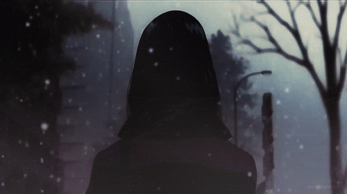
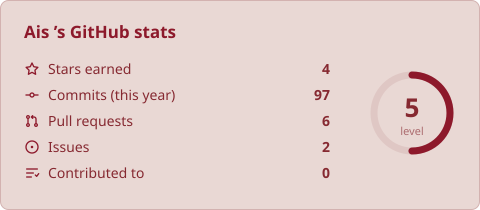
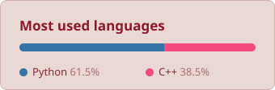
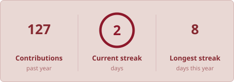
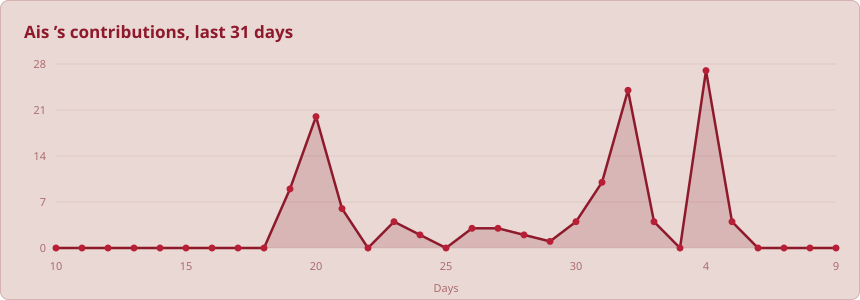

<!-- studio:settings user=Ais-KSA theme=dark hl=3 border=show follow=on light=rose -->

<!-- studio:banner after=0 -->

  <picture>
    <source media="(prefers-color-scheme: dark)" srcset="https://raw.githubusercontent.com/Ais-KSA/Ais-KSA/main/profile-assets/banner-dark.svg?text=1.618%20%CE%A6&shape=cylinder&paint=theme&section=header&height=126&fontSize=57" />
    
  </picture>

<!-- studio:image -->

  <picture>
    <source media="(prefers-color-scheme: dark)" srcset="https://github.com/Ais-KSA/Ais-KSA/blob/main/asdf.gif?raw=true" />
    
  </picture>

<!-- studio:split w=40.a -->
<table>
  <tr>
    <td width="40%" valign="top">

### About me

Name: Ais
Field: Chemistry
Interests:
  - Chemical Sciences
  - Programming
  - Scientific Exploration
  - Technology

</td>
    <td width="60%" align="center" valign="top">
      <picture>
        <source media="(prefers-color-scheme: dark)" srcset="https://raw.githubusercontent.com/Ais-KSA/Ais-KSA/main/profile-assets/card-stats-dark.svg?show_icons=true" />
        
      </picture>
    </td>
  </tr>
</table>

<!-- studio:langs+streak -->

  <picture>
    <source media="(prefers-color-scheme: dark)" srcset="https://raw.githubusercontent.com/Ais-KSA/Ais-KSA/main/profile-assets/card-langs-dark.svg?layout=compact&langs_count=8" />
    
  </picture>
  <picture>
    <source media="(prefers-color-scheme: dark)" srcset="https://raw.githubusercontent.com/Ais-KSA/Ais-KSA/main/profile-assets/card-streak-dark.svg" />
    
  </picture>

<!-- studio:divider -->

<!-- studio:stack per=10 -->
<h3 align="center">Tools I use</h3>

  <picture>
    <source media="(prefers-color-scheme: dark)" srcset="https://raw.githubusercontent.com/Ais-KSA/Ais-KSA/main/profile-assets/stack-dark.svg?i=linux%2Cpy&perline=11" />
    
  </picture>

  <b>Tools</b> 
  <picture>
    <source media="(prefers-color-scheme: dark)" srcset="https://raw.githubusercontent.com/Ais-KSA/Ais-KSA/main/profile-assets/stack-tools-dark.svg?i=vscode%2Cgit%2Cgithub%2Cnotion%2Ccpp&perline=10" />
    
  </picture>

<!-- studio:divider -->

<!-- studio:achievements -->
### Achievements

  
  

<!-- studio:activity -->

  <picture>
    <source media="(prefers-color-scheme: dark)" srcset="https://raw.githubusercontent.com/Ais-KSA/Ais-KSA/main/profile-assets/card-activity-dark.svg?area=true" />
    
  </picture>

<!-- studio:image -->

  <a href="https://pin.it/To5DkL2aq"><picture>
    <source media="(prefers-color-scheme: dark)" srcset="https://raw.githubusercontent.com/Ais-KSA/Ais-KSA/3a6a5f6397eefb43feebb4d03ffc82e45c3f1918/%D8%AA%D9%86%D8%B2%D9%8A%D9%84.gif" />
    
  </picture></a>

